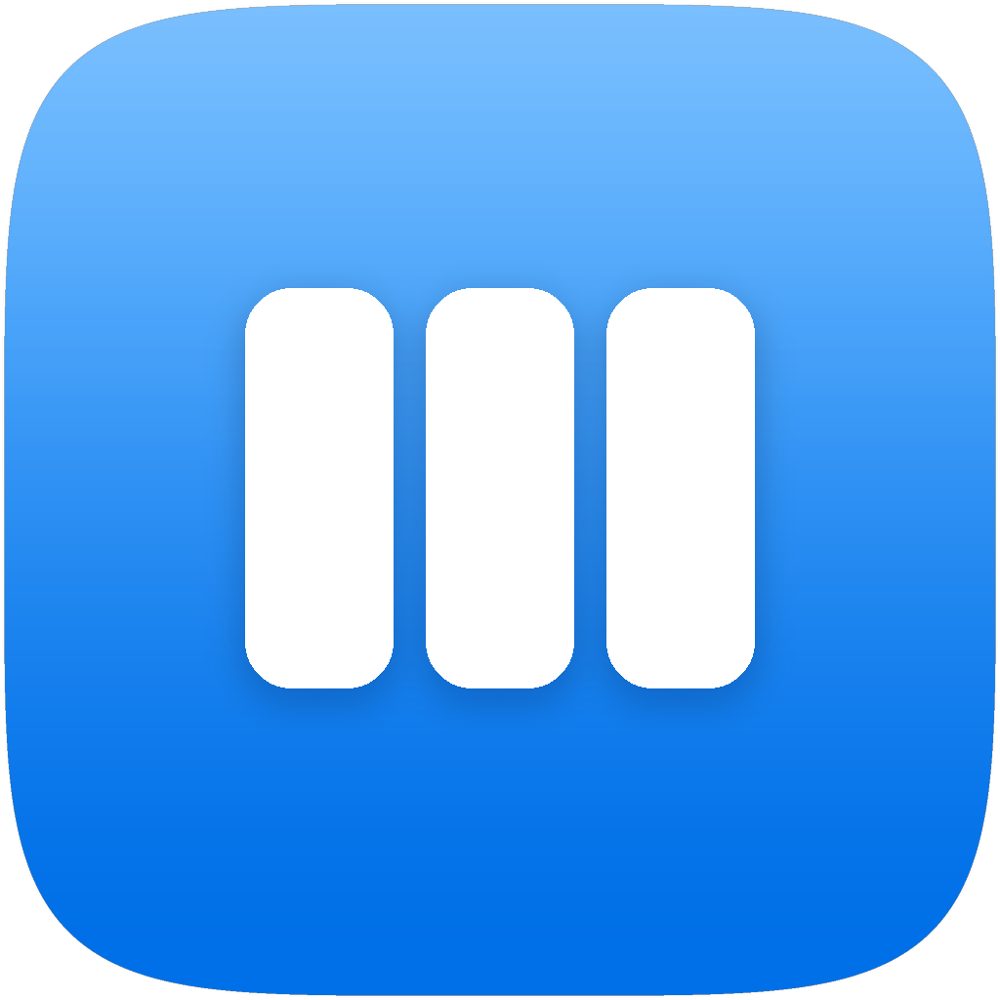
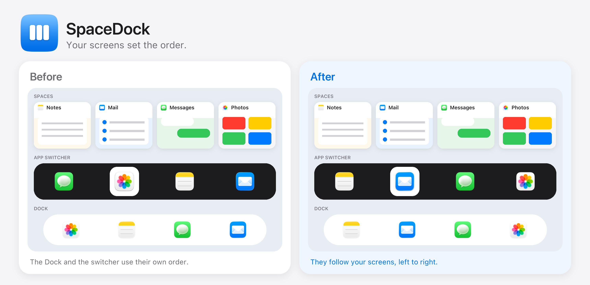

# SpaceDock

<p align="center">
  
</p>



SpaceDock keeps the Mac Dock in the same left-to-right order as your full-screen Spaces. Command-Tab lists those same full-screen apps, in that order.

Spaces stay in charge. Move a full-screen app and the Dock follows. Command-Tab lists the same apps, left to right. Let go of Command to switch. Shift goes backwards. Escape cancels.

## Install

Download the latest [SpaceDock disk image](https://github.com/Humanleap/SpaceDock/releases/latest) and open SpaceDock. It installs for this user and starts again at login.

The first open can ask you to allow it in Privacy & Security. Allow it there, then open it again.

Or build it. You need macOS 14 or later and the Xcode command line tools.

```
git clone https://github.com/Humanleap/SpaceDock.git
cd SpaceDock
make install
```

It runs in the background. Nothing is added to the menu bar or the Dock. macOS asks you to allow SpaceDock to control the computer. Allow it, or Command-Tab stays the usual most-recent list. The Dock order itself does not need that permission.

If you allow it while SpaceDock is already running, it restarts itself once so Command-Tab can take over.

It starts again at login. `make uninstall` removes it.

## Update

A copy installed from the disk image checks for a new release and switches to it.

A copy built with `make install` stays on that build. In the SpaceDock folder:

```
make update
```

That downloads the latest copy, rebuilds it, and starts it again. Updating on the same Mac keeps the Accessibility permission.

To sign it with your own certificate: `make install SIGN_ID="Apple Development: Your Name (TEAMID)"`.

To publish a release, bump `CFBundleShortVersionString` and `CFBundleVersion` in Info.plist, commit, and run `make release`.

## What it changes

It rewrites the Dock's pinned apps to match your full-screen apps, and turns off the Dock setting that sorts apps by when you opened them. Recent apps stay hidden. Folders you added stay. Apps you pinned yourself stay after the full-screen ones. Finder stays first. Other open apps that are not full screen stay after those.

It watches the display that has the most full-screen apps.

Command-Tab is drawn by SpaceDock. macOS does not let an app change the built-in switcher order. Reading Spaces uses a private macOS call, so a system update can break that order until this project is updated.

## License

MIT. Copyright 2026 Humanleap.
